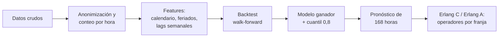

# Pronóstico de llamadas de un call center


Trabajo final de **Machine Learning** de la Universidad Católica del Uruguay (UCU). Tema: **series temporales**.

El proyecto predice cuántas llamadas van a entrar a un call center en **cada una de las 168 horas de la semana siguiente** y traduce ese pronóstico a una decisión concreta: **cuántos operadores hacen falta en cada franja** para cumplir el nivel de servicio (80 % de las llamadas atendidas en menos de 20 segundos).

Se trabajó con datos reales de un call center de Uruguay, del 17/11/2025 al 16/11/2026, agregados por hora y anonimizados.

---

## Contenido

- [Resultados principales](#resultados-principales)
- [Cómo funciona](#cómo-funciona)
- [Instalación](#instalación)
- [Uso](#uso)
- [Datos y privacidad](#datos-y-privacidad)
- [Estructura del proyecto](#estructura-del-proyecto)
- [Decisiones metodológicas](#decisiones-metodológicas)
- [Limitaciones y trabajo futuro](#limitaciones-y-trabajo-futuro)
- [Autor](#autor)

---

## Resultados principales

Comparación de modelos con **validación walk-forward de 8 semanas**, medida solo en horario de atención:

| Modelo | MAE | RMSE | WAPE (%) | Mejora vs. naive (%) |
|---|---:|---:|---:|---:|
| **Gradient Boosting** | **9,84** | **17,88** | **24,7** | **15,7** |
| Random Forest | 10,72 | 19,53 | 26,9 | 8,2 |
| Ridge | 10,79 | 18,85 | 27,1 | 7,5 |
| Naive estacional (baseline) | 11,67 | 22,78 | 29,3 | 0,0 |
| Holt-Winters | 11,82 | 20,86 | 29,6 | −1,2 |

- **Gradient Boosting** es el mejor modelo: le erra en promedio por ~10 llamadas por hora y le gana al baseline en 7 de las 8 semanas de prueba.
- **Validar respetando el tiempo importa.** Sobre las mismas semanas, un k-fold con filas mezcladas estimó un MAE de 6,66, el walk-forward 9,11 y el error real en las 4 semanas siguientes fue 10,55. El k-fold prometía un error 37 % menor al real por *leakage* temporal.
- **El escenario alto está calibrado.** El cuantil 0,8 cubre el 82,1 % de las horas en datos no vistos, por eso se usa para dimensionar.
- **Impacto en la operación.** Con la dotación propuesta, Erlang A estima que se atendería el 96 % de las llamadas, contra un 83,7 % histórico.

El análisis completo está en el [informe](informe/informe.docx).

---

## Cómo funciona



1. **Datos:** se cargan los datos, se borran las columnas con información personal y se cuentan las llamadas por hora.
2. **Features:** hora, día de la semana, feriados uruguayos (incluye Carnaval y Turismo), lags de 1 a 4 semanas y medias móviles.
3. **Modelos:** naive estacional (baseline), Holt-Winters, Ridge, Random Forest y Gradient Boosting.
4. **Validación:** backtest walk-forward con `TimeSeriesSplit`, para no entrenar nunca con datos del futuro.
5. **Pronóstico:** se usa el modelo que ganó el backtest para la media y un Gradient Boosting cuantil para el escenario alto.
6. **Dotación:** Erlang C calcula los operadores necesarios y Erlang A verifica el nivel de atención esperado.

---

## Instalación

Requisitos: **Python 3.10 o superior**.

```bash
git clone https://github.com/ValeRodMa/pronostico-llamadas.git
cd pronostico-llamadas

python -m venv .venv
source .venv/bin/activate        # en Windows: .venv\Scripts\activate
pip install -r requirements.txt
```

---

## Uso

### App interactiva (Streamlit)

```bash
streamlit run app.py
```

Se abre en el navegador en <http://localhost:8501>. La app recorre todo el proceso paso a paso: datos crudos, anonimización, exploración, features, validación, comparación de modelos, incertidumbre y pronóstico.

Si no hay datos reales, la primera vez genera datos simulados para que se pueda probar igual.

### Línea de comandos

```bash
python main.py evaluar        # backtest walk-forward de todos los modelos
python main.py pronosticar    # pronóstico de la semana siguiente + operadores
python main.py simular        # regenera los datos simulados
```

Opciones útiles:

| Opción | Por defecto | Descripción |
|---|---|---|
| `--datos RUTA` | `data/raw/llamadas.csv` | Archivo de llamadas a usar (si no existe, usa los simulados) |
| `--semanas N` | `8` | Semanas de prueba en el backtest |
| `--cuantil Q` | `0.8` | Cuantil del escenario alto |
| `--nivel X` | `0.8` | Nivel de servicio objetivo |
| `--segundos S` | `20` | Tiempo objetivo de atención (segundos) |

Los resultados se guardan en `resultados/` (métricas, predicciones del backtest y pronóstico semanal).

### Tests

```bash
pytest
```

Incluyen un test que verifica que **ninguna feature use datos del futuro**.

---

## Datos y privacidad

Los datos reales **no se suben al repositorio**. Van en `data/raw/llamadas.csv`, que está en el `.gitignore`.

Se aceptan dos formatos, que se detectan automáticamente por las columnas (`src/datos.py`):

- **Reporte "Datos de las Colas"**: ya agregado, una fila por hora, sin datos personales.
- **Export por llamada**: una fila por llamada (como el dataset simulado).

También se pueden cargar desde la app, en `.csv` o `.xlsx`.

Antes de cualquier análisis se **eliminan las columnas con datos personales** (teléfono, id de cliente, operador). Si el export usa otros nombres de columna, hay que ajustar el diccionario `COLUMNAS` en `src/datos.py`.

---

## Estructura del proyecto

```
pronostico-llamadas/
├── app.py                 # App de Streamlit con el recorrido paso a paso
├── main.py                # El mismo pipeline desde la terminal
├── requirements.txt
├── src/
│   ├── datos.py           # Carga, anonimización, agregación por hora y simulación
│   ├── features.py        # Calendario, feriados de Uruguay, lags y medias móviles
│   ├── modelos.py         # Naive, Holt-Winters, Ridge, Random Forest, Gradient Boosting y cuantiles
│   ├── validacion.py      # Backtest walk-forward y comparación con k-fold
│   ├── metricas.py        # MAE, RMSE, WAPE, pinball loss y cobertura
│   ├── erlang.py          # Erlang C (dimensionar) y Erlang A (verificar)
│   └── exploracion.py     # Autocorrelación y mapa de calor
├── tests/
│   ├── test_features.py   # Ninguna feature usa datos del futuro
│   ├── test_datos.py      # Detección de formato y carga del reporte por hora
│   └── test_erlang.py
└── informe/
    └── informe.docx       # Informe: marco teórico, metodología y resultados
```

---

## Decisiones metodológicas

- **Horizonte de una semana (168 h)**, porque los turnos se planifican por semana. El modelo predice la semana entera de una vez, así que solo usa lags de 168 horas o más. La app permite extenderlo a 2, 3 o 4 semanas y mide cómo cambia el error.
- **Walk-forward en lugar de k-fold**, para no entrenar con datos posteriores a los que se predicen.
- **Holt-Winters como referencia clásica**, con estacionalidad aditiva (de noche hay horas con 0 llamadas y la multiplicativa necesita valores positivos) y período 168 (el patrón semanal ya contiene al diario).
- **La demanda son todas las llamadas que entraron** (atendidas + abandonadas). Si se contaran solo las atendidas, el modelo aprendería a pedir menos gente justo donde más faltó.
- **Las métricas se calculan solo en horario de atención.**
- **El modelo final no es fijo:** se usa el que gana el backtest, porque depende de los datos. Con los datos simulados (con tendencia) ganaba Ridge; con los reales ganan los árboles.
- **Escenario alto con regresión cuantil** (Gradient Boosting con pérdida cuantil, q = 0,8), porque quedarse corto de operadores cuesta más que sobrar.
- **Erlang C decide y Erlang A verifica.** Erlang C supone que nadie corta (conservador); Erlang A usa la paciencia estimada del histórico para predecir el nivel de atención.

---

## Limitaciones y trabajo futuro

| Limitación | Qué se podría hacer |
|---|---|
| Un solo año de datos: la estacionalidad anual se ve una sola vez | Conseguir más historia |
| Se pronostica el total de todas las colas juntas | Correr el pipeline para cada cola |
| Los árboles no extrapolan si el nivel cambia rápido | Predecir relativo al nivel y comparar siempre contra el naive |
| Los cuantiles bajos quedan descalibrados cuando cambia el nivel | Calibración conformal (CQR) |
| Erlang supone llegadas Poisson y tiempos exponenciales | Simular la cola y estimar la paciencia con análisis de supervivencia |
| Una persona que vuelve a llamar cuenta dos veces | Quitar duplicados por número antes de anonimizar |

---

## Autor

**Valentín Rodríguez Machado**
Trabajo final del curso de Machine Learning, Universidad Católica del Uruguay, 2026.
